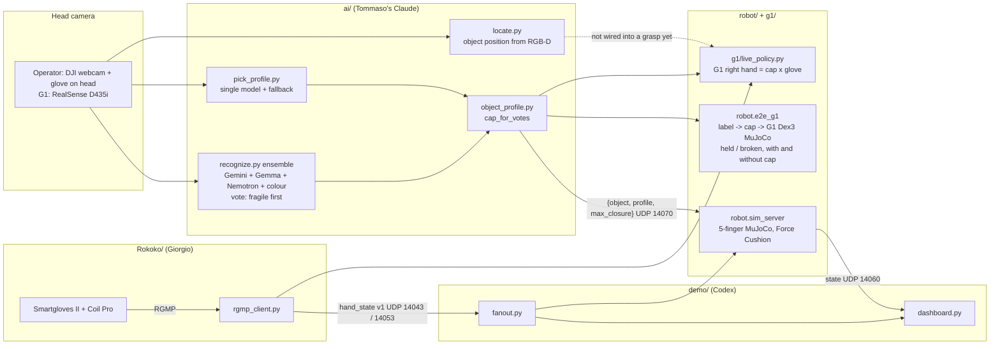

# Architecture

Gloves have no force sensors. A head camera sees **what** the hand is about to grasp; several recognisers vote on the object; the result selects a per-object **closure limit** the robot hand cannot exceed. The robot side runs in MuJoCo simulation; the real G1 test is a first try at 10% closure.

Status as of 14/11 afternoon (`main` at 510cc14). Wording follows the safe phrasing of `docs/ORCH_BACKLOG.md` section 1.

## Data flow

Dashed arrows are not wired today.

## Grip rule (`ai/object_profile.py`, `cap_for_votes`)
- Egg and unknown objects never get full closure. Unknown, error or no answer -> conservative cap 0.68.
- Egg and stress ball share one cap (0.70), so an egg/ball mix-up neither drops nor crushes the egg in the simulation.
- The stress ball gets full closure (1.0) **only** if at least 2 independent recognisers agree with confidence >= 0.9, or the operator sets it by hand (`--set stress_ball`). One confident model is not enough: confidence does not separate right from wrong answers (`docs/OBJECT_RECOGNITION_RESULTS.md`).
- The can is recognised but not grasped (vision only, `supported=false` in `g1/object_profiles.json`).
- Closure levels are tuned in simulation; forces printed by the simulation are model outputs with assumed thresholds, not measurements.

Tests: `python3 -m pytest tests/test_cap_for.py tests/test_picker_safety.py tests/test_live_policy_cap.py -q`.

## Recognisers (same 50 head-camera photos, `docs/OBJECT_RECOGNITION_RESULTS.md`)

| Recogniser | Where | Result |
|---|---|---|
| Nemotron 3.5 Super VL (NVIDIA, Verda) | `ai/pick_profile.py`, `ai/recognize.py` | 48/50 in two runs, median 0.22 s per call (second run) |
| Gemma 4 26B A4B (Google API) | `ai/recognize.py` | 49/50, eggs 20/20, median 7.7 s |
| Gemini 3.5 Flash | `ai/recognize.py` | full run not finished (spot test only) |
| Colour rule (local, no network) | `ai/color_baseline.py` | 38/50, untuned |
| **Ensemble Nemotron + Gemma, fragile first** | `ai/recognize.py` | **50/50**, computed offline from the saved answers |
| YOLO-World-S (local) | `cv/` | 12/50, not used (`docs/CV_RESULTS.md`) |

Fragile-first vote: any answer "egg" with confidence >= 0.6 makes the result egg; otherwise majority. Backends run in parallel with a 15 s timeout; no answer -> conservative cap. Command: `python -m ai.recognize photo.jpg --backends gemini,gemma,nemotron,color`.

## Object position (`ai/locate.py`)
G1 head RGB-D -> object centre in the pelvis frame, with refusals (`depth_ok=False`) for mixed depth, objects cut by the frame edge and occluded balls. Measured only in simulation: `python -m ai.locate_bench` on MuJoCo renders of the G1 head camera, 20 placements per object, median xy error 0.14-0.26 cm with a perfect mask. Not tested on real G1 frames, not wired into a grasp.

## G1: simulation and first live test
- **Simulation, end to end**: `python -m robot.e2e_g1 --label egg` (no key needed) or `--image <photo> --recogniser nemotron`. Egg with its cap: held intact; without the cap: broken. Egg mistaken for a stress ball (`--true egg --label stress_ball`): held intact thanks to the shared cap. Right hand only, fixed base, assumed gains and break thresholds.
- **Real G1**: `g1/live_policy.py`, procedure in `docs/G1_LIVE.md`. Arms stay still; the right Dex3 hand follows the glove up to the object cap. Rehearsed on the organisers' mock runner (about 30 Hz, 0 clipped steps). The first live test is at 10% closure (`G1_MAX_CLOSURE=0.1`); no real-robot result is recorded in the repo.

## UDP ports (all 127.0.0.1)

| Port | Payload | Producer -> consumer |
|---|---|---|
| 12276 | Raw RGMP | Rokoko Studio / `Rokoko/src/replay_rgmp.py` -> `rgmp_client.py` |
| 14043 | hand_state v1 `{fingers[5], hand, t, ...}` | `rgmp_client.py` / mock -> fanout, `g1/live_policy.py --source udp:14043` |
| 14053 | Bimanual `{left, right, t}` | `rgmp_client.py --bimanual-port` -> fanout |
| 14044 / 14045 / 14046 | Copies of the glove stream | fanout -> dashboard / `robot.run_udp` / `robot.sim_server` |
| 14060 | Sim state `{obj, force, broken, lifted, cap, profile}` | `robot.sim_server` -> dashboard |
| 14070 | `{object, profile, max_closure, max_speed}` | `ai.pick_profile` / `ai.recognize --publish` -> sim_server, run_udp |

Contracts: `docs/contracts.md`.

## Folder boundaries (AGENTS.md section 4)

| Folder | Owner | Role |
|---|---|---|
| `Rokoko/`, `ml/`, `vision/`, `g1/` | Giorgio's agents | Glove capture, episodes, G1 IK, grasp physics, live policy |
| `ai/`, `robot/` | Tommaso's Claude | Recognition ensemble, locate, object -> cap, e2e sim command, Dex3 retargeting |
| `demo/`, `deck/`, `docs/PITCH*.md` | Tommaso's Codex | Dashboard, demo, pitch |
| `cv/` | Tommaso's Codex-CV | Local detector benchmark |
| `docs/ARCHITECTURE.md`, `docs/submission/`, `README.md` | Tommaso's Docs | This page, submission drafts |

## What is not shown yet
- No result from the real G1 is recorded; the first test is at 10% closure.
- The live G1 policy uses the single-model picker, so there the ball reaches full closure only with a manual `--object stress_ball`.
- `locate()` is not wired into a grasp and not tested on real frames.
- The can is recognised but not grasped.
- Recognition: one person, one place, one day, 50 photos, no held-out set; the ensemble 50/50 is computed offline on the same photos.
