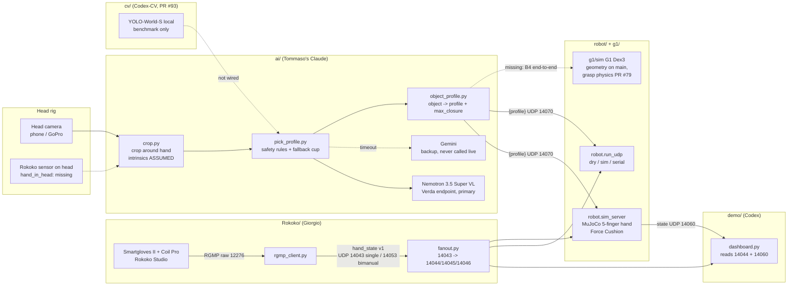

# Architecture

Gloves have no force sensors. A head camera sees **what** the hand is about to grasp; a model names the object; the name selects a per-object **closure limit** that the robot hand cannot exceed. Everything below runs on a laptop; the robot side is simulated in MuJoCo.

Status labels used on this page: **main** = code on `main` with a command; **PR** = code in an open PR, not on `main`; **missing** = does not exist yet. Source for every status: `docs/ORCH_BACKLOG.md` section 1.

## Data flow

Dashed arrows are not wired on `main` today.

## UDP ports (all 127.0.0.1)

| Port | Payload | Producer -> consumer | Source |
|---|---|---|---|
| 12276 | Raw RGMP | Rokoko Studio (or `Rokoko/src/replay_rgmp.py`) -> `rgmp_client.py` | `docs/contracts.md` |
| 14043 | hand_state v1 `{fingers[5], hand, t, ...}` | `rgmp_client.py` / `mock_stream.py` -> `demo/fanout.py` | `docs/contracts.md` |
| 14053 | Bimanual `{left[5]\|null, right[5]\|null, t}` | `rgmp_client.py --bimanual-port` -> fanout | `docs/contracts.md` |
| 14044 / 14045 / 14046 | Copies of the glove stream | fanout -> dashboard / `robot.run_udp` / `robot.sim_server` | `demo/run_demo.sh` |
| 14060 | Sim state `{obj, force, broken, lifted, cap, profile, latency}` | `robot.sim_server` -> dashboard | `robot/sim_server.py` |
| 14070 | `{"profile": "cup\|egg\|can\|none"}` | `ai.pick_profile` -> sim_server, run_udp | `docs/contracts.md` |

## Recognition tiers

| Tier | Where | Status | Measured |
|---|---|---|---|
| 1. Nemotron 3.5 Super VL (NVIDIA, Verda endpoint) | `ai/llm.py`, `ai/pick_profile.py` | main; model id marked unverified in `ai/llm.py`; endpoint timed out from 11:45 | 48 of 50 of our photos, one run (`docs/OBJECT_RECOGNITION_RESULTS.md`) |
| 2. Gemini (Google) | `ai/pick_profile.py` backup, `ai/eval_objects.py --backend gemini` | main; never called live; id `gemini-2.5-flash` unverified | none |
| 3. Local detector YOLO-World-S | `cv/` | PR #93 | 12/50 on the same photos, 0/20 eggs: not usable as picker (`docs/CV_RESULTS.md` in #93) |
| Last resort | `python -m ai.pick_profile --set egg` | main | manual |

Safety rules in the picker (`python3 -m pytest tests/test_picker_safety.py -q`): fallback is `cup`, never "no limit"; a `stress_ball` answer with confidence < 0.9 becomes `egg`; confidence < 0.6 becomes at most `cup`. Thresholds are hand-picked, tested with fake transports only.

## Folder boundaries (AGENTS.md section 4)

| Folder | Owner | Role |
|---|---|---|
| `Rokoko/`, `ml/`, `vision/`, `g1/` | Giorgio's agents | Glove capture, episodes, G1 IK and grasp physics, profile numbers |
| `ai/`, `robot/` | Tommaso's Claude | Recognition, object -> profile table, Force Cushion, Dex3 retargeting |
| `demo/`, `docs/PITCH*.md` | Tommaso's Codex | Dashboard, one-command demo, pitch |
| `cv/` | Tommaso's Codex-CV | Local detector benchmark |
| `docs/ARCHITECTURE.md`, `docs/submission/`, `README.md` | Tommaso's Docs | This page, submission drafts |

## What is not connected yet

- No command runs photo -> object -> profile -> G1 grasp in MuJoCo -> held/broken (backlog B4).
- The MuJoCo grasp with a closure limit on `main` uses a 5-finger hand (`robot/scene.py`), not the G1 Dex3. G1 Dex3 grasp physics is in PR #79.
- The can is recognised but not held by the simulated G1 hand (`g1/sim/GRASP_REPORT.md` in PR #79).
- Head sensor pose and `hand_in_head` are in no episode on `main`; camera intrinsics are assumed.
- Nothing has run on the real G1.
