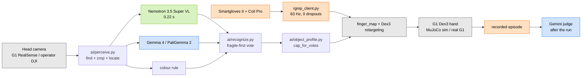
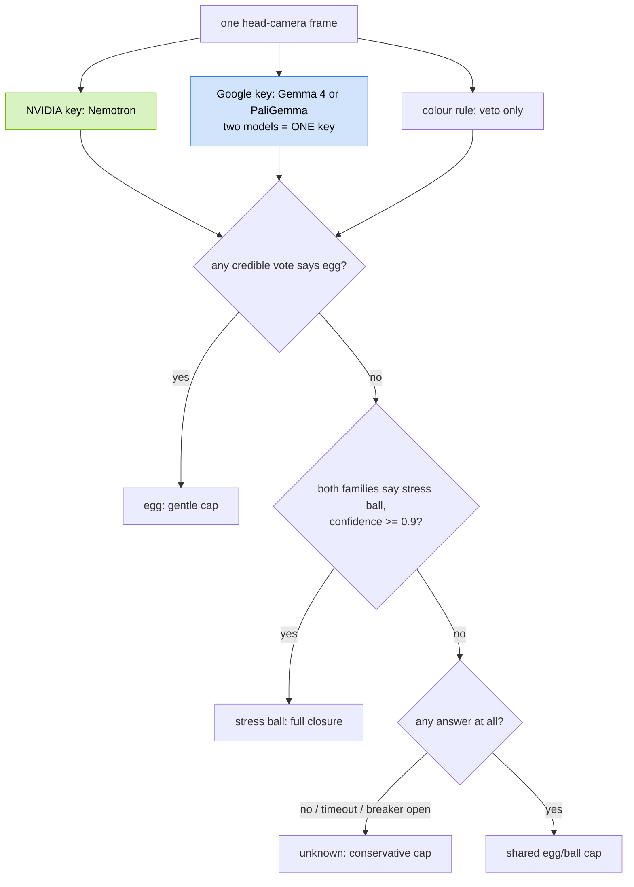
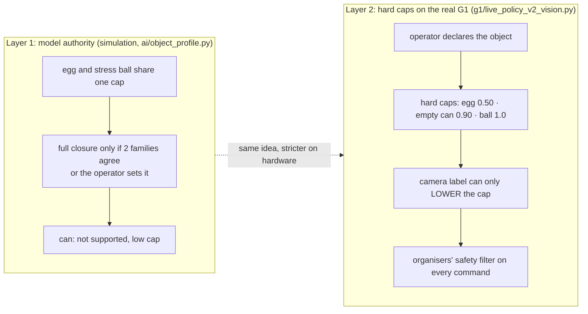
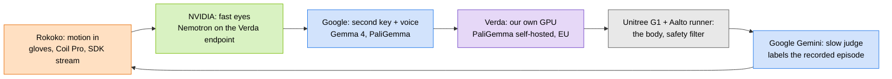

# D — Architecture diagrams (Mermaid)

Render with any Mermaid viewer (GitHub renders them inline). Colours: Rokoko = orange, NVIDIA = green, Google = blue, Verda = purple, Unitree/Aalto = grey.

## 1. End-to-end pipeline: glove → camera → vote → cap → hand

## 2. Fragile-first vote, counted per model family

Measured on our 50 photos: 3 of 3 Nemotron/Gemma disagreements were exactly one model's error; the photo two models got wrong (egg-012) was saved by the third model's "egg".

## 3. Two safety layers: simulation rule vs real robot

Why two layers: in simulation the models are allowed to decide, under the two-family rule. On the real robot the operator decides the ceiling and vision can only make the hand gentler. The vision → cap path on the real robot has been tested on simulated frames only.

## 4. Where each sponsor's technology sits

