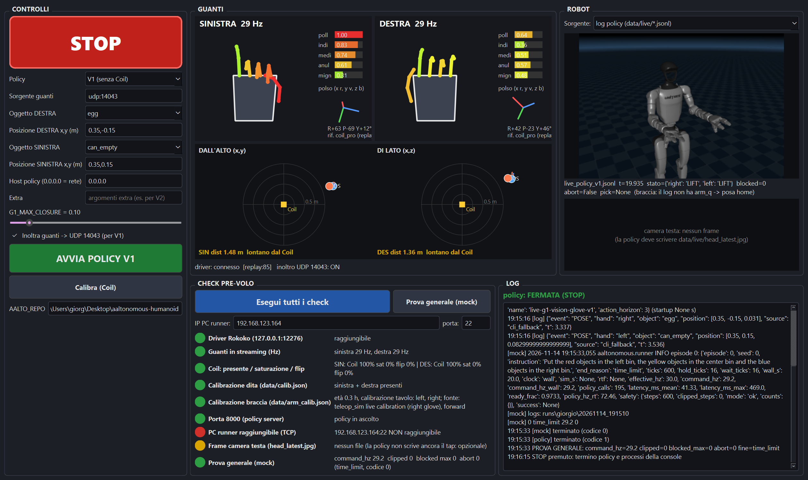

# Console operatore G1

One window for the real-robot test: pre-flight checks, gloves + Coil, robot preview, start/STOP of the policy.

```
py -3.11 tools/console/app.py                      # gloves from the Rokoko driver 127.0.0.1:12276
py -3.11 tools/console/app.py --gloves replay:85   # gloves from a recorded take (no gloves needed)
py -3.11 tools/console/app.py --checks             # run all checks at start
```



## Panels
- **CONTROLLI**: big red **STOP** (kills the policy process tree and every process the console started: `taskkill /T /F`),
  policy V1 / V2 (V2 is enabled only when `g1/live_policy_v2.py` exists), glove source, object + x,y position per hand (pelvis frame, m),
  policy host (`0.0.0.0` so the runner PC can reach `ws://<this pc>:8000`; the policies default to 127.0.0.1), extra args,
  `G1_MAX_CLOSURE` slider (default 0.10, passed as env to the policy), **Calibra (Coil)** = `tools/console/calib_coil.py`
  (the table calibration of `g1/sim/teleop_sim.py --calib`, without starting the teleop sim; writes `data/arm_calib.json`).
- **Inoltra guanti -> UDP 14043** (on by default): the console reads the driver itself, maps fingers with `data/calib.json`
  and sends `{"left":[5],"right":[5],"t"}` to 127.0.0.1:14043, which is what V1's `--source udp:14043` reads.
  So `rgmp_client.py` is not needed. Turn it off if another forwarder already sends to 14043.
- **GUANTI**: 2D skeleton of both hands seen from the back (bend per finger incl. thumb, colour green->red), bars 0..1,
  wrist orientation triad + roll/pitch/yaw (reference frame shown); top (x,y) and side (x,z) view of both wrists in the
  Coil frame with distance and warnings (Coil not seen, saturation = too close, far).
- **ROBOT**: offscreen MuJoCo G1 (`g1/arm_ik.G1Arms`) at ~15 fps. Source "log policy": last line of the newest
  `data/live/*.jsonl`; uses `arm_q_target`/`arm_q_cmd`/`arm_q` and `hand_q_target`/`hand_q` when present.
  **V1 logs only `hand_q`, so the arms stay at the home pose** (V2 can add `arm_q` to its log to show the arms).
  Source "guanti dal vivo": hands only, gloves -> Dex3 retargeter at the slider's max closure.
- **Camera testa**: the head-camera frames reach only the policy (runner -> policy server). The console shows
  `data/live/head_latest.jpg` if the policy writes it (frame tap, optional; border green if < 2 s old). **Neither V1 nor V2
  writes it today**: a policy that wants it should save the RGB frame there, e.g. at 2-5 Hz with `cv2.imwrite` to a temp file + `os.replace`.
- **CHECK PRE-VOLO** ("Esegui tutti i check"): driver reachable, glove rate (Hz), Coil present/saturation/flip per glove,
  `data/calib.json`, `data/arm_calib.json` age + table calibration, port 8000 free/listening, runner PC reachable (IP + TCP port,
  default 22), frame tap age. **Prova generale (mock)**: V1 with `--source replay:77,78` on localhost (port 8000, or 8765 if 8000 is
  busy) + `g1/run_mock_gate.py` (organisers' mock runner, 20 s, `AALTO_REPO`), then shows command_hz / clipped / max blocked / aborts.
- **LOG**: stdout of the processes started by the console + events (`POSE`, `ABORT`, ...) from the policy log; status line with state/blocked/abort.

## Not verified without the robot
Real runner connecting to `0.0.0.0:8000` over the robot network; robot behaviour when STOP kills the policy (runner watchdog);
the frame tap (no policy writes it yet); two clients on the Rokoko driver at once (console + V2/teleop if V2 reads the driver directly);
the calibration with gloves on (tested only the no-Coil failure path).
